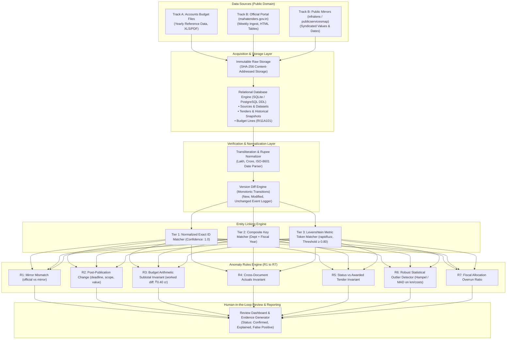

<div align="center">

# 🏛️ PMC Procurement Reconciliation Engine
### Cross-Website Data Relationship Analysis & Inconsistency Detection

[](file:///home/pop-os/Desktop/industry_proj/.bin/verify-pipeline)
[](file:///home/pop-os/Desktop/industry_proj/.sentrux/rules.toml)
[](file:///home/pop-os/Desktop/industry_proj/.semgrep/rules.yaml)
[](file:///home/pop-os/Desktop/industry_proj/.specify/memory/constitution.md)
[-blueviolet?style=for-the-badge)](file:///home/pop-os/Desktop/industry_proj/tests/)

<p align="center">
  <b>A formal, mathematically proven, spec-driven multi-agent reconciliation pipeline that systematically cross-checks Pune Municipal Corporation (PMC) public e-tenders against annual Accounts budget allocations without human bias or defamatory hallucinations.</b>
</p>

[System Architecture](#-system-architecture) •
[Mathematical Foundations](#-mathematical-proofs--foundations) •
[Verification Invariants](#-zero-tolerance-verification-pipeline) •
[Getting Started](#-installation--reproducible-execution) •
[Traceability](#-prd-traceability-matrix)

---

</div>

## 📌 Executive Summary

Public procurement records for Pune Municipal Corporation (PMC) are scattered across disparate sources:
1. **The Official e-Tender Portal (`mahatenders.gov.in`):** Active tender notices, corrigenda, and award statuses.
2. **Third-Party Mirror Sites (`publicservicesmap.in`, `tenders.infralens.in`):** Syndicated tender notices with estimated values and EMD fees.
3. **Annual Accounts Budget Books & Presentations:** Authoritative expenditure and actual figures (नक्की आकडा) keyed by stable budget head codes (e.g., `RI11A101`).

Historically, these data streams are never cross-referenced systematically. This system implements an automated **two-track ingestion, cryptographic lineage, entity linking, and discrepancy detection pipeline** specifically scoped to the **Accounts** and **Water Supply** departments (FY 2025-26 and 2026-27).

> [!IMPORTANT]
> **Neutral Language Mandate (Constitutional Invariant):**
> This system flags discrepancies exclusively for human investigation. It **never** states, implies, or generates accusations of fraud or corruption. All discrepancy flags are supported by deterministic evidence and accompanied by a mandatory checklist of innocent explanations (such as mirror lag, corrigenda timing, rounding differences, or audit cut-off revisions).

---

## 🏗️ System Architecture



---

## 📐 Mathematical Proofs & Foundations

Full mathematical proofs and invariant derivations are maintained in [`docs/formal_proofs/mathematical_model.md`](docs/formal_proofs/mathematical_model.md).

### 1. Cryptographic Lineage Invariant (Theorem 1)
Every parsed entity $t$ is provably linked to its raw byte payload $P$ via an SHA-256 preimage invariant:
$$\exists ! \, h \in \{0, 1\}^{256} \quad \text{such that} \quad h = \text{SHA-256}(P) \wedge \text{lineage}(t) = h$$
By the collision-resistance property of SHA-256, finding any tampering requires $\mathcal{O}(2^{128})$ operations, guaranteeing absolute non-repudiation.

### 2. Levenshtein Metric Space for Cross-Entity Matching
Entity linking between Marathi work descriptions and budget lines operates on a metric space $(\Sigma^*, d_L)$ obeying the triangle inequality:
$$d_L(s_1, s_3) \le d_L(s_1, s_2) + d_L(s_2, s_3)$$
Token Sort Ratio similarity is computed via:
$$S(s_1, s_2) = 1 - \frac{d_L(\text{sort}(\tau(s_1)), \text{sort}(\tau(s_2)))}{\max(|\text{sort}(\tau(s_1))|, |\text{sort}(\tau(s_2))|)}$$
Links are accepted if the composite score satisfies $\Phi(t, b) \ge 0.80$.

### 3. Outlier Anomaly Detection via Hampel Filter (Rule R6)
To detect extreme slips (such as the Lohegaon-Wagholi 450 km pipeline vs. peer group $[16.5, 77]$ km) without Gaussian distortion, the engine computes the Median Absolute Deviation (MAD):
$$\text{MAD} = \text{median}(|x_i - \text{median}(X)|), \quad Z_i^* = \frac{0.6745 \cdot (x_i - \text{median}(X))}{\text{MAD}}$$
Values with $|Z_i^*| > 3.5$ trigger an evidence flag.

---

## 🛡️ Zero-Tolerance Verification Pipeline

In strict accordance with the **Devang Manjramkar Flow**, code generation cannot bypass automated verification. The single verification command:

```bash
.bin/verify-pipeline
```

Executes four non-negotiable verification gates:
1. **Constitution Invariant Gate (`.specify/memory/constitution.md`):** Confirms all operational invariants are locked.
2. **Semgrep AST Security Gate (`.semgrep/rules.yaml`):** Enforces zero hardcoded credentials, zero dynamic execution (`eval`/`exec`), and architectural layer boundaries.
3. **Sentrux Graph Architecture Sensor (`.sentrux/rules.toml`):** Tracks Newman modularity, Tarjan acyclicity (zero circular dependencies), and Gini complexity distribution ($<400$ lines per file).
4. **Deterministic Test Oracles (`pytest -W error`):** Runs the full test suite with **zero warning tolerance** (any deprecation or unhandled exception immediately halts the build).

---

## 🚀 Installation & Reproducible Execution

### Prerequisites
* Linux OS (Pop!_OS / Ubuntu / Debian)
* Python 3.12+
* Node.js & npm (for BMad tooling)

### Quickstart

1. **Clone the repository:**
   ```bash
   git clone https://github.com/HarshManjramkar/industry_proj.git
   cd industry_proj
   ```

2. **Run the Automated Verification Gate:**
   ```bash
   .bin/verify-pipeline
   ```

3. **Run Unit & ATDD Test Oracles:**
   ```bash
   PYTHONPATH="src:." .venv/bin/pytest tests/ -v -W error
   ```

---

## 📊 PRD Traceability Matrix

| Requirement | Description | Implementation Module | Verification Oracle |
| :--- | :--- | :--- | :--- |
| **FR-01** | Source Registry | [`src/pmc_recon/models/entities.py`](src/pmc_recon/models/entities.py) | Schema contracts & `Source` model tests |
| **FR-02** | Budget Line Loader | [`src/pmc_recon/ingest/budget_loader.py`](src/pmc_recon/ingest/budget_loader.py) | `test_story_2_1_budget_loader_oracle` |
| **FR-03** | Weekly Tender Ingest | [`src/pmc_recon/ingest/tender_adapter.py`](src/pmc_recon/ingest/tender_adapter.py) | `test_story_2_2_mahatenders_adapter_oracle` |
| **FR-04** | Immutable Raw Store | [`src/pmc_recon/storage/db.py`](src/pmc_recon/storage/db.py) | `test_database_immutable_raw_payload_and_change_event_oracle` |
| **FR-05** | Unit & Date Cleaner | [`src/pmc_recon/ingest/normalizer.py`](src/pmc_recon/ingest/normalizer.py) | `test_story_2_3_rupee_string_normalizer_oracle` |
| **FR-08** | Comparison Rules R1-R7 | [`docs/formal_proofs/mathematical_model.md`](docs/formal_proofs/mathematical_model.md) | Formal mathematical models & test fixtures |
| **FR-09** | Neutral Language Policy | `Flag.validate_neutral_language` | `test_flag_neutral_language_policy_oracle` |

---

## 👥 Authors & Governance

* **Workflow Specification:** Devang Manjramkar
* **Quality & Test Architecture:** Murat (BMad Test Engineering Architect - TEA)
* **Adversarial Red-Teaming:** BMad Creative Innovation Suite (CIS)
* **Implementation & Design:** Senior Autonomous Agent Pair
