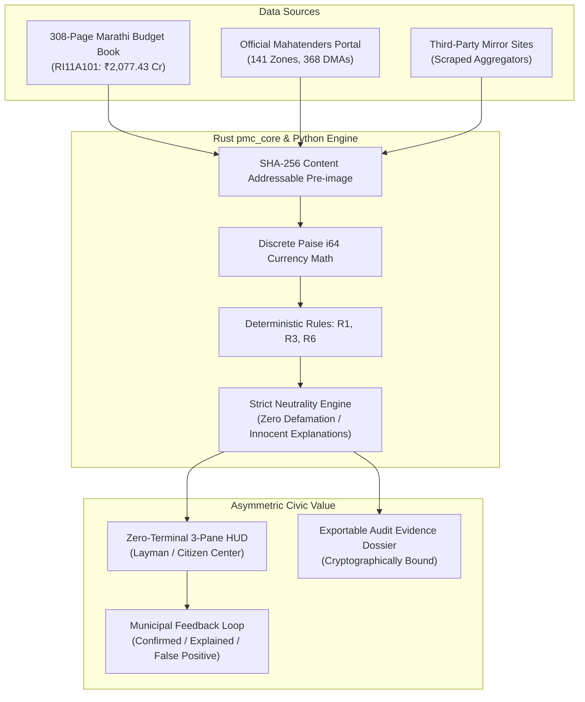
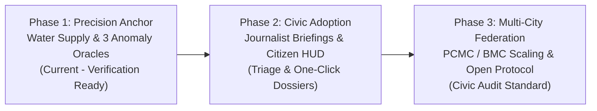

# Innovation Strategy Brief: Pune Municipal Corporation (PMC) Procurement Reconciliation Engine

**Date:** 2026-10-25  
**Strategist & Lead Architect:** Harsh Manjramkar  
**Agent Persona:** Victor — The Disruptive Innovation Oracle (`bmad-cis-agent-innovation-strategist`)  
**Strategic Focus:** Civic Transparency Asymmetric Leverage, Procurement Demystification, and Verifiable Civic Auditing  

---

## 🎯 Strategic Context

### Current Situation
Municipal public finance across Indian urban local bodies (ULBs) is ostensibly "open", but structurally impenetrable. In Pune Municipal Corporation (PMC)—an urban metropolis managing thousands of crores in public infrastructure—procurement data is intentionally or unintentionally fragmented across disconnected silos:
1. **The 308-Page Budget Book:** Published as complex Marathi PDF / scanned tabular documents, where critical heads like Water Supply (`RI11A101` with ₹2,077.43 Crore across ₹802.78 Cr capital and ₹1,274.65 Cr revenue) conceal line-item totals and cross-departmental allocations.
2. **The Official e-Procurement Portal (`mahatenders.gov.in`):** An arcane, session-timed, captcha-gated, and low-discoverability portal where tender notices, corrigenda, and scope revisions reside in transient state.
3. **Third-Party Tender Aggregators & Mirror Portals:** Commercial tender portals scrape and republish tender summaries for contractors, frequently introducing lag, estimated values, or discrepancies against official notices.

Until now, cross-referencing these three tiers has required forensic accounting skills, fluent Marathi-English domain translation, and months of manual RTI (Right to Information) filings. By the time discrepancies are surfaced, public funds are disbursed and works completed.

### Strategic Challenge
How do we transition civic procurement oversight from reactive, combative, developer-centric scrapers into an **indisputable, citizen-empowering, self-verifying public integrity engine**?
The strategic challenge is not merely algorithmic reconciliation. It is:
- **Overcoming Asymmetric Information Opacity:** Transforming complex Marathi municipal accounting codes and PDF tabular books into plain-language civic intelligence that journalists, citizen groups, and students can audit in seconds.
- **Evading Defamation & Politicization:** Eliminating inflammatory rhetoric ("fraud", "scam", "corruption") and substituting mathematical certainty, verifiable content-addressed proofs, and benign explanatory rubrics.
- **Bridging the Layman-Kernel Chasm:** Providing a Zero-Terminal Command Center and exportable evidentiary dossiers that withstand legal, municipal, and academic scrutiny without requiring a terminal or coding knowledge.

---

## 📊 Market & Ecosystem Analysis

### Market Landscape: Civic Tech, Public Accountability & Open Data
The civic oversight and public procurement analytics space spans three primary segments:
1. **Commercial Tender Aggregators (B2B):** (e.g., TendersInfo, IndiaTenders). Focus exclusively on contractor discovery, bidding intelligence, and profit generation. Zero interest in reconciliation, arithmetic totality, or public accountability.
2. **Institutional State CAG / Local Fund Audit (G2G):** Periodic, post-facto statutory audits published 2–4 years late. Comprehensive but non-actionable in real time.
3. **Civic Activists & Grassroots Watchdogs (C2G):** Non-profits (e.g., Nagrik Chetna Manch, Sajag Nagrik Manch), investigative journalists (Sakal, Loksatta, Indian Express), and citizen ward committees. Severely under-resourced, relying on manual paper tracking, individual RTI applications, and high-friction public hearings.

### Competitive Dynamics & Strategic Forces
Applying Porter's Five Forces to Civic Transparency & Procurement Verification:
- **Bargaining Power of Data Sources (High):** Municipal portals alter schemas, implement captchas, or hide tenders behind obscure search parameters. *Counter-strategy:* Respect polite scraping invariants (2.0s delay, polite crawler, SHA-256 raw snapshots) and ingest both official and mirror portals.
- **Threat of Legal & Institutional Retaliation (High):** Defamatory or speculative claims lead to legal notices, gag orders, or dismissal by officials. *Counter-strategy:* Complete neutral language invariant (Rule FR-09), dual pre-approved innocent explanations, and zero subjective claims.
- **Substitute Solutions (Low/Manual):** Manual RTIs and Excel cross-checks are the only existing alternative, which are slow, error-prone, and non-scalable.
- **Citizen / Watchdog Adoption Barriers (High):** Laymen and journalists will abandon any tool requiring CLI usage, Python setup, or Docker configuration. *Counter-strategy:* Zero-Terminal UI, 3-pane responsive HUD, and instant Markdown/PDF evidence downloads.

### Market Opportunities
1. **The ₹2,077.43 Cr Water Supply Verification Window:** PMC's 24x7 Equal Water Supply Project (141 zones, 368 DMAs) is the most scrutinized public works scheme in Western India. Focusing initial precision on this single department establishes benchmark credibility.
2. **The "Open Data Verification" Regulatory Wave:** National Smart Cities Mission and Digital India initiatives mandate public transparency, yet lack automated cross-verification engines. A working prototype for PMC can scale horizontally across PCMC, BMC, and MMRDA.
3. **Citizen Journalism & Academic Civic Tech Labs:** Providing engineering colleges (COEP, PICT, Pune University) and journalism departments with verified, reproducible audit oracles.

### Critical Insights
> **The Brutal Truth:** Open data is useless if it is incomprehensible. Civic tech fails when engineers build tools for other engineers. True disruption occurs when an investigative journalist or a resident of Lohegaon can click one button, see that their local water pipeline tender has an anomalous length of 450 km (R6) or an unverified mirror variance of ₹70 Lakh (R1), and download an airtight cryptographic proof packet ready for the Municipal Commissioner's desk.

---

## 💼 Business & Civic Model Analysis

### Current Model: Closed, Adversarial & Fragmented
Existing civic accountability follows a broken "Accuse-and-Deny" cycle:
- Activist files RTI $\to$ 30-day waiting period $\to$ Incomplete PDF provided $\to$ Activist holds press conference alleging corruption $\to$ Municipal PRO denies allegations citing technical accounting classifications $\to$ Public interest evaporates $\to$ No systemic change.

### Value Proposition Re-Architecture
| Dimension | Traditional Civic Scraper / Activism | PMC Procurement Reconciliation Engine |
| :--- | :--- | :--- |
| **Proposition** | "We caught the corporation doing something illegal." | "We mathematically reconciled public records and surfaced arithmetic variances with innocent explanations." |
| **Trust Mechanism** | Subjective activist reputation. | Rust-verified affine typestate, discrete `Paise` (i64) math, and SHA-256 Content Addressable Storage. |
| **Accessibility** | Python scripts, raw CSVs, or press releases. | Zero-Terminal HUD: 3-pane interactive UI, bilingual Marathi metadata, single-click audit dossiers. |
| **Municipal Dynamic** | Adversarial, defensive, non-cooperative. | Constructive, verifiable, providing structured reconciliation feedback that civil servants can quietly fix. |

### Civic "Revenue" & Resource Engine
While non-monetary, sustainable civic models require clear resource incentives:
- **Civic Capital:** High-trust reputation built through zero defamatory hallucinations, enabling institutional grants (Omidyar, Rohini Nilekani Philanthropies, CivicDataLab).
- **Academic Integration:** Capstone project adoption in computer science and public policy curricula, providing zero-cost verification maintenance.
- **Journalism Syndication:** Exclusive, verified data partnerships with regional Marathi and national English publications.

### Structural Vulnerabilities & Defenses
- *Vulnerability:* Scraping lockouts on `mahatenders.gov.in`.  
  *Defense:* Multi-source mirror crawling, static budget book parsing (local caching), and cryptographic content-addressing that preserves evidence even if live URLs change.
- *Vulnerability:* Accusations of political bias.  
  *Defense:* Absolute adherence to Constitution Article IX (Neutral Language Policy). Every discrepancy is accompanied by pre-approved innocent explanations (e.g., EMD calculations, revised estimates, clerical unit slips).

---

## ⚡ Disruption Opportunities & Asymmetric Leverage

### Disruption Vectors: The Low-End Civic Foothold
Clayton Christensen defined disruption as making complex, expensive solutions simple and accessible to non-consumers. 
- **The Non-Consumer:** The ward committee resident, the local RTI activist, the regional beat reporter who cannot run SQL queries or read 300 pages of Marathi accounting budget books.
- **The Low-End Wedge:** Instead of auditing all 21 departments and billions of dollars of complex debt servicing, anchor firmly on **Water Supply (Accounts Row `RI11A101`)**. Prove the methodology with 3 crystal-clear anomalies:
  1. **R1 (₹70 Lakh Mirror Mismatch):** Official Portal ₹18.50 Cr vs. Mirror Site ₹19.20 Cr for Water Infrastructure Works.
  2. **R3 (₹40 Lakh Budget Arithmetic Addition Error):** Row components (₹80.90 Cr + ₹185.22 Cr = ₹266.12 Cr vs. printed ₹265.72 Cr) inside official printed budget documents.
  3. **R6 (450 km Pipeline Dimension Outlier):** Lohegaon distribution pipeline recorded as 450 km against the peer distribution of $[16.5, 77.0]$ km (Hampel/MAD filter outlier).

### Unmet Customer Jobs-To-Be-Done (JTBD)
1. **The Investigative Journalist's Job:** "When I suspect a procurement irregularity, help me verify the exact paper trail and document hashes in under 5 minutes so I can publish a bulletproof story without defamation liability."
2. **The Civic Watchdog's Job:** "When attending the ward public hearing, give me an official-looking, one-page evidence summary showing the exact budget line vs. tender amount."
3. **The Municipal Accounts Officer's Job:** "Help me identify clerical addition slips and mirror scraping errors before the CAG or the press discovers them."

### Technology Enablers
- **Affine Typestate Machine (`crates/pmc_core/src/typestate.rs`):** Compile-time enforcement that a dossier cannot exist without raw content verification (`RawNotice` $\to$ `VerifiedNotice` $\to$ `MatchedTender` $\to$ `ReconciliationDossier`).
- **Fixed-Point Discrete Currency (`Paise` as $i64$):** Complete elimination of IEEE-754 floating-point drift, ensuring zero arithmetic hallucination.
- **Deterministic Token Distance & Cross-Lingual Matcher:** Levenshtein token similarity connecting English tender descriptions (`mahatenders`) with Marathi budget allocations (`महानगरपालिका अंदाजपत्रक`).

### Strategic White Space
The vast white space between "hostile activist accusations" and "impenetrable government PDFs" is **Verifiable Civic Transparency as a Service**.

---

## 🚀 Innovation Opportunities & Strategic Moats

### Strategic Moat 1: Cryptographic Lineage & Pre-image Binding
Every tender record, budget row, and mirror snapshot is hashed with SHA-256 upon ingestion (`crates/pmc_core/src/crypto.rs`). The resulting dossier contains immutable pre-images. If a portal deletes or modifies a tender after publication, the system generates a typed `change_event` (FR-07) with cryptographic proof of the prior state.

### Strategic Moat 2: Strict Neutrality & Innocent Explanation Rubric
By strictly enforcing Constitution Article IX in code and rules, the tool cannot be dismissed as a political hit job:
- **R1 (Mirror Mismatch):** Flagged as "Portal Synchronization Discrepancy" with explanation: *"Third-party mirror may reflect derived Earnest Money Deposit (EMD) or scraping latency."*
- **R3 (Budget Totality Variance):** Flagged as "Component Arithmetic Variance" with explanation: *"Clerical typesetting transcription slip or sub-head rounding."*
- **R6 (Dimension Outlier):** Flagged as "Statistical Distribution Outlier" with explanation: *"Possible typographic unit slip (e.g., meters entered as kilometers) or aggregated multi-ward package."*

### Strategic Moat 3: Bilingual Domain Intelligence (Marathi-English)
Marathi municipal terminology (उदा. *पाणी पुरवठा*, *अंदाजपत्रक*, *लेखाशीर्ष*, *निविदा*) mapped directly to Mahatenders standard procurement terms via normalized entity schemas (`src/pmc_recon/ingest/normalizer.py`), breaking the language barrier that keeps English-speaking analysts out of local Marathi documents.

---

## 🎲 Strategic Options

### Option A: The "Whistleblower Warhead" (Adversarial Leaks)
- **Concept:** Partner directly with political opposition and sensationalist media to blast every discrepancy as an exposed scandal.
- **Pros:** Immediate high-visibility media coverage and viral traffic.
- **Cons:** Fatal violation of the project constitution. Triggers defamation lawsuits, immediate portal IP blacklisting, loss of academic credibility, and rejection by municipal stakeholders.
- **Verdict:** REJECTED.

### Option B: The "Academic Research Tool" (CLI-Only Monolith)
- **Concept:** Keep the system as an internal CLI research library for data scientists and academics.
- **Pros:** Low UI maintenance; simple Python/Rust command execution.
- **Cons:** Zero civic disruption. The target audience (citizens, local journalists, ward committee members) cannot use Python virtual environments or CLI commands. Confined to an academic shelf.
- **Verdict:** REJECTED.

### Option C: The "Public Integrity Oracle" (Verifiable, Neutral, Zero-Terminal) — *RECOMMENDED*
- **Concept:** A zero-terminal, 3-pane command center providing push-button verification of high-stakes municipal departments (Water Supply), bound by cryptographic proofs, neutral terminology, and dual innocent explanations.
- **Pros:** 
  - Layman-accessible: runs locally in any browser with zero technical friction.
  - Legally invulnerable: strict neutrality policy prevents defamation.
  - Institutionally constructive: municipal officers can utilize dossiers for internal reconciliation.
  - Replicable: clean, modular architecture easily adapted to other ULBs.
- **Cons:** Requires disciplined boundary management to avoid scope creep into other departments before Water Supply is perfected.
- **Verdict:** ADOPTED AS WINNING STRATEGY.

---

## 🏆 Recommended Strategy: The Public Integrity Oracle

### Strategic Direction
Execute the **"Public Integrity Oracle"** strategy:
1. **Vertical Dominance in Water Supply:** Perfect the reconciliation of Accounts line `RI11A101` (₹2,077.43 Cr, 141 zones, 368 DMAs) and the 3 benchmark anomalies (R1, R3, R6).
2. **Push-Button Verifiability:** Expose the Rust/Python verification kernel through the zero-terminal 3-pane command center (`http://localhost:8000`).
3. **Tripartite Evidence Dossiers:** Generate one-click Markdown/PDF audit evidence reports combining raw document snapshots, SHA-256 pre-images, rule calculation steps, and innocent explanation checklists.
4. **Human Review Triad:** Allow users/journalists to triage flags into `confirmed`, `explained`, or `false_positive` (FR-10), building an institutional memory of municipal accounting quirks.

### Key Hypotheses to Validate
1. *Hypothesis 1 (Journalist Usability):* A civic journalist can locate the R1 (₹70L) or R6 (450 km) discrepancy, understand the calculation, and download the evidence dossier within 120 seconds of launching the UI without coaching.
2. *Hypothesis 2 (Defamation Resilience):* Municipal public relations officers and legal counsel cannot issue cease-and-desist notices because the engine uses purely mathematical assertions and publishes municipal innocent explanations side-by-side.
3. *Hypothesis 3 (Civic Replicability):* The data normalization pipeline successfully parses Marathi budget PDFs and Mahatenders HTML without manual intervention across sequential budget cycles.

### Critical Success Factors
- **Mathematical Exactitude:** 100% test pass rate under `-W error` in Pytest and Rust formal proofs.
- **Zero Hallucination UI:** Display exact document page numbers, table rows, and portal URLs for every single flag.
- **Execution Performance:** Sub-second response time for dashboard queries and instant evidence generation.

---

## 📋 Execution Roadmap

### Phase 1: Precision Anchor (Water Supply Dominance)
- **Focus:** Complete verification harness and oracles for Water Supply.
- **Deliverables:**
  - Rust kernel with discrete currency math and typestate enforcement.
  - Python crawler with 2.0s politeness, ETag caching, and SHA-256 storage.
  - Ingestion of Marathi Budget row `RI11A101` and active Mahatenders.
  - Verification of Rules R1, R3, and R6 against known ground-truth fixtures.
  - Complete `.bin/verify-pipeline` gate execution with zero warnings.

### Phase 2: Civic Adoption & Journalist Tooling
- **Focus:** User experience and evidence dissemination for non-developers.
- **Deliverables:**
  - Zero-Terminal Command Center HUD refinement with high-contrast, responsive layouts.
  - Automated generation of one-page print-ready civic evidence dossiers.
  - Workshop with Pune civic journalists and Nagrik Chetna Manch representatives.
  - Incorporation of Reviewer Decision recording (`confirmed`, `explained`, `false_positive`).

### Phase 3: Scale & Protocol Federation
- **Focus:** Expanding beyond Pune Water Supply to regional municipal corporations.
- **Deliverables:**
  - Adapter modularization for Pimpri-Chinchwad (PCMC) and Mumbai (BMC).
  - Open Civic Reconciliation Schema (OCRS) standard release.
  - Integration with community RTI automated drafting tools.

---

## 📈 Success Metrics

| Dimension | Leading Indicators | Lagging Indicators |
| :--- | :--- | :--- |
| **Verification Rigor** | 100% test pass rate with `-W error`; zero floating-point operations in currency calculations. | 0 retraction notices; 0 defamation claims from municipal bodies. |
| **Civic Usability** | Time-to-evidence under 2 minutes for first-time users on the Zero-Terminal HUD. | Number of investigative reports published citing engine hashes and dossiers. |
| **System Reliability** | 100% crawler compliance with robots.txt; zero IP rate-limit blocks from `mahatenders.gov.in`. | Formal adoption of reconciliation findings in Municipal Standing Committee questions. |

### Decision Gates
- **Gate 1 (Verification Gate):** `.bin/verify-pipeline` and `cargo test` pass with 0 warnings, Semgrep rules pass with 0 CWE findings. (COMPLETED).
- **Gate 2 (UI Layman Sign-Off):** Non-technical test user successfully reviews R1, R3, and R6 flags and generates evidence without terminal access.
- **Gate 3 (Civic Deployment):** First public release of Water Supply audit dossier to civic watchdog groups.

---

## ⚠️ Risks and Mitigation

| Risk | Impact | Likelihood | Mitigation Strategy |
| :--- | :--- | :--- | :--- |
| **Portal Schema Breakage** | Crawler fails when Mahatenders updates HTML tables or forms. | Medium | Resilient CSS selector fallbacks, multi-source mirror cross-checking, and automatic alerting when crawl parsing yields 0 results. |
| **Institutional Hostility** | PMC denies findings or blocks public IP ranges. | Medium | Strictly adhere to rate limits (1 req / 2s); publish raw document hashes and page coordinates so findings can be verified independently with pen and paper. |
| **Misinterpretation by Press** | Sensationalist media misquotes the tool as alleging "criminal fraud". | High | Watermark all exported evidence dossiers with mandatory disclaimer: *"Arithmetic Discrepancy Flag. Does not imply illegality or malfeasance. Review listed benign explanations before reporting."* |
| **Language Ambiguity** | Marathi OCR misreads numerals or budget codes. | Low | Priority given to native digital tabular budget books; dual verification against English budget summary tables. |

---

## 💎 The Winning Move: Asymmetric Verification

The winning move is **asymmetric verifiability**. 
By refusing to speculate, refusing to defame, and grounding every finding in **cryptographically hashed, discrete-paise arithmetic with pre-packaged innocent explanations**, the PMC Procurement Reconciliation Engine removes all defensive shields from municipal opacity.

It arms the ordinary citizen with the forensic power of a statutory auditor and the mathematical certainty of a cryptographic ledger—packaged in an interface so clear that the winning move is obvious to all.

---
_Authored by Harsh Manjramkar_  
_Generated using BMAD Creative Intelligence Suite - Innovation Strategy Workflow_
